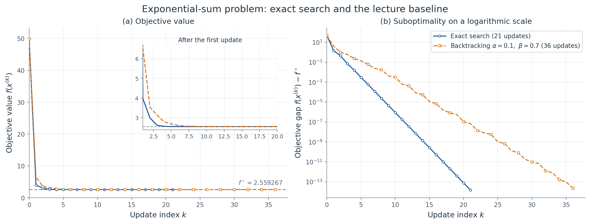

# 凸优化课程：第一次大作业

两题均采用未归一化负梯度下降。代码、全部实验结果与图表对应同一套配置。

## 快速运行

```bash
python3 -m pip install -r requirements.txt
python3 run_experiments.py
python3 run_tests.py
```

也可执行 `python3 -m pip install -e .`，然后使用 `convex-optim-run` 与 `convex-optim-plot`。
核心实验依赖 NumPy 和 Matplotlib，测试使用标准库 unittest；无需 GPU，也无需 SciPy。

## 与课件对齐的关键约定

- 仅完成第一次作业截图中的两题，第 80 页的 Newton 方法属于第二次作业。
- 精确搜索使用课件的 `argmin f(x-t*g)`；第二题用一维导数零点的区间二分数值计算该步长。
- 两题主停止都采用 `||gradient|| <= 1e-6`；这是可修改的实验精度，不是老师指定数字。
- 第一题另统计 `R_k <= 1e-8` 首达轮，作为相对误差诊断，不改变主停止。
- 第一题 `x0=(gamma,1)`；第二题所有组 `x0=(1,1)`；回溯每轮从 `t=1` 开始。

详细推导见 [课件对齐与公式](docs/COURSE_ALIGNMENT.md)，完整结果分析见 [阶段 2 结果讲义](docs/PHASE2_REPORT.md)。

## 正式结果

20 组配置全部收敛，18 项测试通过。第一题的理论与实测如下：

| $\gamma$ | $\kappa$ | $K_g$ 理论 / 实测 | $K_R$ 理论 / 实测 | 最终 $\|g\|_2$ |
| --- | --- | --- | --- | --- |
| $0.01$ | 100 | 478 / 478 | 461 / 461 | 9.9660e-07 |
| $0.1$ | 10 | 60 / 60 | 46 / 46 | 8.3465e-07 |
| $1/3$ | 3 | 19 / 19 | 14 / 14 | 8.9913e-07 |
| $1$ | 1 | 1 / 1 | 1 / 1 | 0.0000e+00 |
| $3$ | 3 | 23 / 23 | 14 / 14 | 5.0576e-07 |
| $10$ | 10 | 83 / 83 | 46 / 46 | 8.2613e-07 |
| $100$ | 100 | 939 / 939 | 461 / 461 | 9.8672e-07 |

第二题：精确搜索 **21 次**，课件基准回溯 `(alpha,beta)=(0.1,0.7)` **36 次**。
全部回溯配置的更新次数：

| $\alpha$ | $\beta=0.3$ | $\beta=0.5$ | $\beta=0.7$ | $\beta=0.9$ |
| --- | --- | --- | --- | --- |
| 0.01 | 18 | 33 | 202 | 186 |
| 0.1 | 18 | 32 | 36 | 51 |
| 0.3 | 19 | 33 | 32 | 38 |

精确搜索的单步最优不保证整个过程迭代最少；`(0.01,0.3)` 与 `(0.1,0.3)` 的实际坐标轨迹完全相同，均为 18 次。



## 文件索引

| 位置 | 内容 |
|---|---|
| `configs/experiments.json` | 所有正式参数、主停止和诊断阈值 |
| `src/convex_optim/` | 目标函数、线搜索、梯度下降、实验与绘图 |
| `results/quadratic_summary.csv` | 第一题全量汇总 |
| `results/exponential_summary.csv` | 第二题全量汇总 |
| `results/experiment_data.json.gz` | 全部逐次轨迹的无损压缩快照 |
| `results/trajectories/` | 运行后生成的各组逐次 CSV |
| `results/gradient_threshold_diagnostics.csv` | 不同梯度阈值的首达轮数 |
| `results/mechanism_checks.json` | 重合轨迹与局部长尾机制核验 |
| `results/validation.json` | 轨迹、计数、Armijo 与正交性核验 |
| `results/test_report.txt` | 18 项测试通过的实际输出 |
| `figures/` | 8 张图的矢量 PDF；PNG 可由绘图命令重建 |
| `docs/` | 理论说明、完整结果分析与可编辑报告源文件 |

## 使用保存的结果，不重新优化

```bash
python3 scripts/unpack_results.py
python3 src/convex_optim/plot_results.py --data results/experiment_data.json --output figures
```

解压脚本从 `.json.gz` 恢复原始 JSON 和逐次 CSV。GitHub 版本保留无损原始数据快照与矢量图；交付压缩包另包含直接可读的全部 CSV、JSON 和 PNG。

## 成本计数口径

`n_full_f` 是完整目标值查询；`n_delta` 是稳定函数差查询；`n_g` 只计外层梯度；`n_slope` 计内层方向导数。
`n_f = n_full_f + n_delta`，因此不能把 `n_f` 与 `n_delta` 再相加。
方向导数内部也使用梯度表达式，但不重复加入外层 `n_g`。精确搜索接受步为记录下降比执行的差值查询也已计数。
不同类型的查询不可等权相加后当成耗时；本项目不根据极短的一次计时声称通用速度优势。

## 修改设置

配置文件记录本次正式实验的全部选择。汇总中的机制检查和绘图面板按本次参数网格设计；若改变网格或初值，需同步调整这些比较项。
学习时可直接调用 `gradient_descent` 接口试验其他配置，并使用返回的 `history` 分析轨迹。

本次实际环境：Python 3.12.14、NumPy 2.3.5、Matplotlib 3.10.8；精确版本见 `requirements-tested.txt`。
程序中闭式公式、解析解和稳定误差用于数学核验与等价求值；优化轨迹由真实的梯度与线搜索循环产生。
