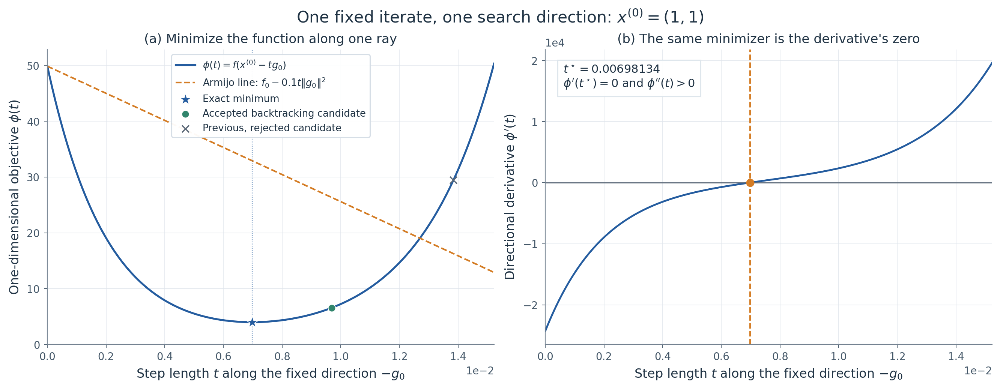
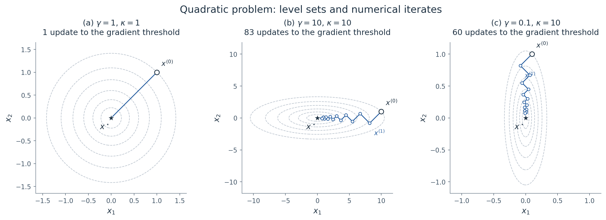
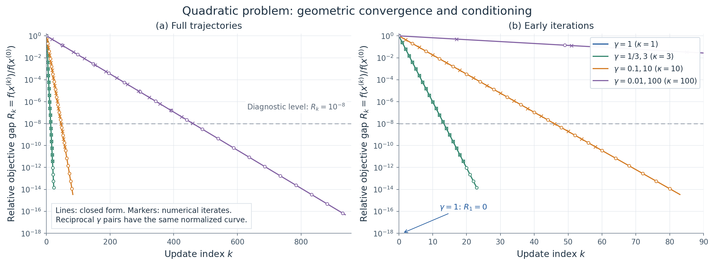
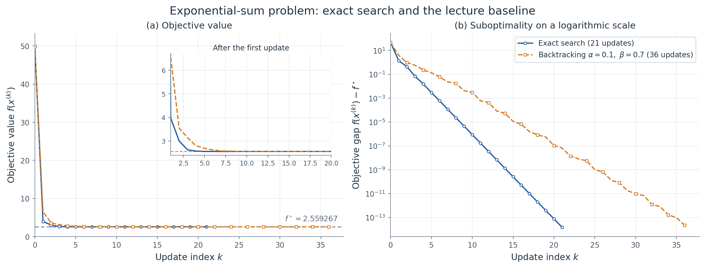
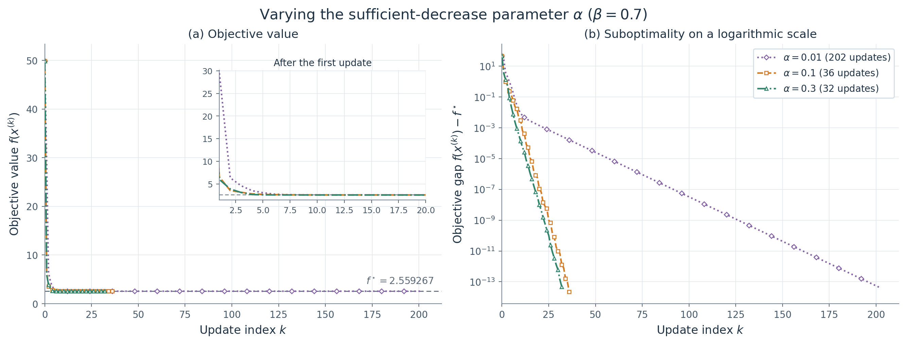
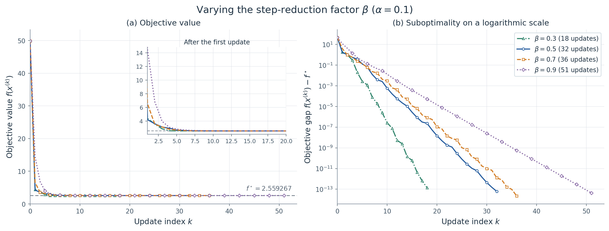
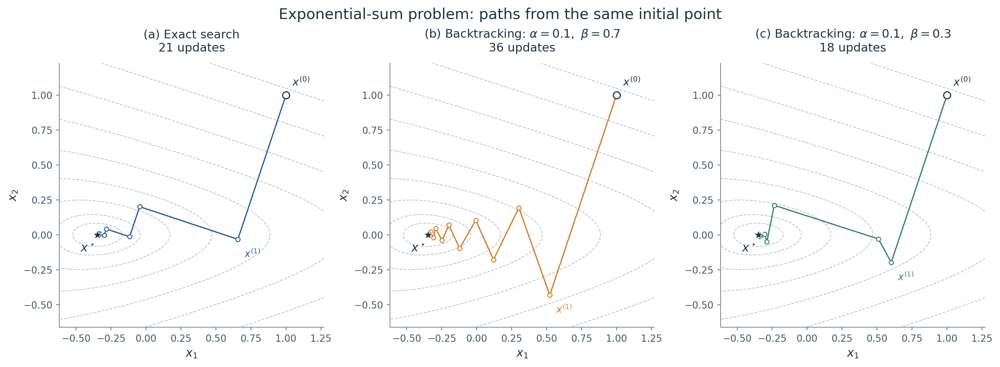
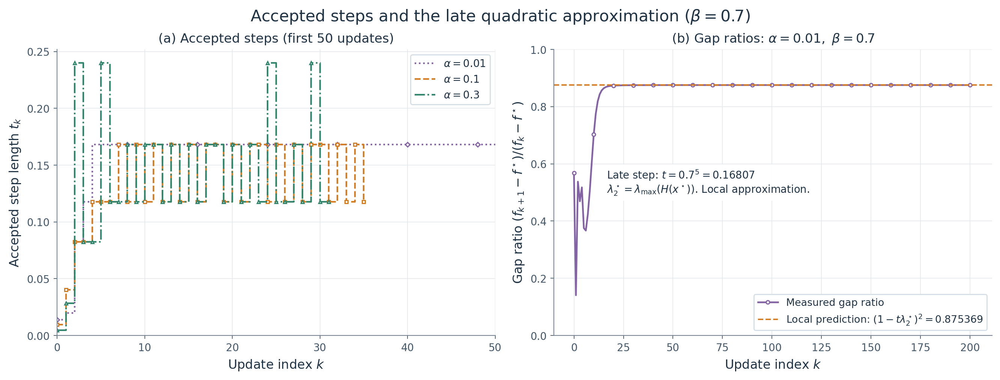

<div class="eyebrow">CONVEX OPTIMIZATION · ASSIGNMENT 1 / PHASE 02</div>

# 第一次凸优化大作业

## 完整实现与结果分析参考

**覆盖范围：**二次函数与三指数非二次函数；均使用梯度下降。本次作业不包含课件第 80 页的 Newton 方法。

**完成状态：**两题共 20 组配置全部达到统一梯度精度；18 项数学与实现测试通过；8 张结果图已生成。全部数值来自实际运行日志。

### 本次最重要的结果

第一题的全部轨迹、主停止次数、相对误差首达次数与解析公式一致。第二题的精确搜索需要 **21 次**更新，课件基准回溯 $(0.1,0.7)$ 需要 **36 次**；本参数网格中最快的两组回溯为 **18 次**。

| $\alpha$ | $\beta=0.3$ | $\beta=0.5$ | $\beta=0.7$ | $\beta=0.9$ |
| --- | --- | --- | --- | --- |
| 0.01 | 18 | 33 | 202 | 186 |
| 0.1 | 18 | 32 | 36 | 51 |
| 0.3 | 19 | 33 | 32 | 38 |

表中数值是回溯法达到 $\|\nabla f\|_2\le10^{-6}$ 的实际更新次数。精确搜索为 21 次。全部配置使用共同初值 $(1,1)$。

### 回应上一阶段的两个疑问

精确搜索仍按课件的 $\arg\min$ 定义；二分求根只计算这个一维最小化的步长。两题主停止规则统一为课件的梯度范数形式；$10^{-6}$ 是明确列出的实验选择，不是题目指定值。

本文按“理论推导 → 编程结果与可视化 → 结合公式解释”组织。完整程序、配置、逐次 CSV、汇总、绘图脚本和测试随项目提供，便于你复现并整理自己的报告。


\clearpage

<div class="eyebrow">01 / COURSE ALIGNMENT</div>

## 1. 先明确课件要求与数值选择

| 类别 | 内容 |
|---|---|
| 题面与课件规定 | 两个目标函数；负梯度方向；精确搜索与回溯定义；第一题初值 $(\gamma,1)$；第二题各组初值相同 |
| 本项目选定 | 第二题初值 $(1,1)$；回溯参数网格；梯度阈值 $10^{-6}$；一维步长容差 $10^{-12}$ |
| 实际结果 | 轨迹、更新次数、函数误差、各类评估次数和参数影响 |

### 1.1 精确搜索不是另一种下降方向

课件第 15、21 页给出：

$$d_k=-g_k=-\nabla f(x^{(k)}),\qquad
t_k=\arg\min_{t\ge0}f(x^{(k)}+td_k).$$

随后更新 $x^{(k+1)}=x^{(k)}+t_kd_k$。这一步只在确定“沿当前负梯度方向走多远”。本项目的外层循环逐项对应这一算法，梯度不归一化。

课件没有规定求出 $t_k$ 的内层数值算法。第一题可直接解出步长公式；第二题需要将一维最小化计算到足够精确。本项目选择区间二分求导数的唯一零点，便于逐行解释。

### 1.2 为什么需要自己选一个停止阈值？

课件第 19、21、26 页写的是 $\|\nabla f(x^{(k)})\|_2\le\varepsilon$，没有指定具体数值。计算机通常不会恰好到达梯度严格为零的点，因此必须给定一个近似精度。

第一阶段曾对第一题使用相对函数误差、第二题使用梯度范数作为主停止条件。它们不是同一个误差量。为更直接对齐课件，第二阶段统一主停止条件；第一题的相对误差保留为分析指标。

### 1.3 范围已经固定

本次仅完成截图中的两题。第 80 页属于第二次作业，已从本次范围移除。课件第 34 页没有给出图中初值的具体坐标，因此本项目说明自己的初值，不声称复刻其图中的每一个迭代次数。


\clearpage

<div class="eyebrow">02 / WHY THE EXACT SEARCH IS THE SAME</div>

## 2. 从 PPT 的 argmin 到可计算的步长

固定某一轮的 $x$ 和 $g=\nabla f(x)$，定义一元函数：

$$\phi(t)=f(x-tg),\qquad t\ge0.$$

课件要做的是沿这条射线找到最低点，即 $t^\star=\arg\min\phi(t)$。由链式法则：

$$\phi'(t)=-g^\top\nabla f(x-tg),$$

$$\phi''(t)=g^\top H(x-tg)g.$$

第二题的 Hessian 处处正定，所以在 $g\ne0$ 时 $\phi''(t)>0$，一元函数严格凸。又有 $\phi'(0)=-\|g\|^2<0$，而远处导数转正，因此存在唯一正零点。

$$\boxed{\arg\min_{t\ge0}\phi(t)\quad\Longleftrightarrow\quad\phi'(t^\star)=0.}$$

### 2.1 二分法只是求出上述零点

先在 $[0,1]$ 检查导数符号；若右端导数仍为负，就扩大右端点。括住根以后，取中点 $m$：若 $\phi'(m)<0$，最低点在右侧；若 $\phi'(m)>0$，最低点在左侧。反复保留正确的一半。

内层停止以步长区间宽度为依据：

$$t_{\mathrm{high}}-t_{\mathrm{low}}
\le10^{-12}+10^{-12}\max(|t_{\mathrm{low}}|,|t_{\mathrm{high}}|).$$

这与外层梯度阈值是两个不同量。不能仅用 $|\phi'(t)|\le10^{-12}$ 判断找到根，因为外层末期 $|\phi'(0)|=\|g\|^2$ 本来就可能约为 $10^{-12}$。

### 2.2 可用于检验的推论

在精确步长处：

$$\phi_k'(t_k)=-g_k^\top g_{k+1}=0.$$

因此相邻梯度正交。正式第二题精确搜索的最大相邻梯度绝对余弦为 $5.35\times10^{-11}$，与该性质一致。这比只看曲线下降更能说明程序确实计算了精确搜索步长。


\clearpage

<div class="eyebrow">03 / ONE LINE SEARCH, VISUALLY</div>

## 3. 同一个起点上的精确搜索与回溯

{width=100%}

共同初值为 $(1,1)$，$f(x^{(0)})=49.857776617481$。左图的蓝色最低点是精确步长；回溯只要求候选点落在 Armijo 直线以下。

| 方法 | 首步 $t_0$ | 首步 $f(x^{(1)})$ | 最终更新数 |
| --- | --- | --- | --- |
| 精确搜索 | 0.006981338337 | 3.974853890926 | 21 |
| (0.1, 0.7) | 0.009688901041 | 6.541376938923 | 36 |
| (0.1, 0.3) | 0.008100000000 | 4.395228988355 | 18 |

### 3.1 课件基准回溯的具体接受过程

对 $(\alpha,\beta)=(0.1,0.7)$，候选步长依次为 $1,0.7,0.7^2,\ldots$。第一个被接受的候选是：

$$t=0.7^{13}=0.009688901041.$$

前一个更大候选 $0.7^{12}=0.013841287201$ 的实际下降比为 $0.060754<0.1$，因此被拒；当前候选的下降比为 $0.184158>0.1$，因此接受。

### 3.2 单步最优与整条轨迹的区别

精确搜索第一步确实得到最低的函数值 $3.974854$，但回溯 $(0.1,0.3)$ 最终只需 18 步，少于精确搜索的 21 步。第一次更新后各方法位于不同位置，后续方向也随梯度改变，所以单步最优不能直接推出整个过程更新次数最少。


\clearpage

<div class="eyebrow">04 / STOPPING AND PRECISION</div>

## 4. 三种阈值分别控制什么？

| 符号 | 本项目数值 | 作用 |
|---|---|---|
| $\varepsilon_g$ | $10^{-6}$ | 两题唯一的主收敛停止标准：$\|g_k\|_2\le\varepsilon_g$ |
| $\varepsilon_R$ | $10^{-8}$ | 第一题归一化误差首达统计；不改变迭代 |
| $\varepsilon_t$ | 绝对与相对容差各 $10^{-12}$ | 第二题每一轮精确搜索的步长计算精度 |

选择 $\varepsilon_g=10^{-6}$，是为了在双精度下得到清楚的收敛曲线和可靠终点。这不是目标函数误差恰好为 $10^{-6}$，也不是各坐标误差恰好为 $10^{-6}$。实际函数误差与点误差另行报告。

### 4.1 不同梯度精度下的首达次数

下面直接从已保存的完整轨迹统计，不另跑或修改算法：

| 方法或 $(\alpha,\beta)$ | $10^{-4}$ | $10^{-5}$ | $10^{-6}$ |
| --- | --- | --- | --- |
| 精确搜索 | 15 | 17 | 21 |
| (0.01, 0.3) | 14 | 16 | 18 |
| (0.01, 0.5) | 24 | 28 | 33 |
| (0.01, 0.7) | 133 | 168 | 202 |
| (0.01, 0.9) | 130 | 158 | 186 |
| (0.1, 0.3) | 14 | 16 | 18 |
| (0.1, 0.5) | 24 | 27 | 32 |
| (0.1, 0.7) | 27 | 32 | 36 |
| (0.1, 0.9) | 37 | 44 | 51 |
| (0.3, 0.3) | 15 | 17 | 19 |
| (0.3, 0.5) | 24 | 28 | 33 |
| (0.3, 0.7) | 23 | 27 | 32 |
| (0.3, 0.9) | 28 | 33 | 38 |

精度收紧会增加更新次数。本次网格中，精确搜索、课件基准与较快回溯组的主要相对关系在这些阈值下保持一致；这一观察仅针对本次函数、初值和参数网格。

最大更新次数设为 10000，用于区分达到精度与未达精度。本次 20 组均正常达到梯度阈值，没有任何组因上限而终止。


\clearpage

<div class="eyebrow">05 / QUADRATIC THEORY</div>

## 5. 第一题：理论先于数值验证

$$f_\gamma(x)=\tfrac12x^\top Ax,\quad A=\operatorname{diag}(1,\gamma),\quad g=Ax.$$

Hessian 正定，最优点为 $0$。沿负梯度展开：

$$f(x-tg)=f(x)-t g^\top g+\tfrac12t^2g^\top Ag.$$

对步长求导为零：

$$\boxed{t_k=\frac{g_k^\top g_k}{g_k^\top Ag_k}.}$$

课件指定 $x^{(0)}=(\gamma,1)^\top$。此时 $g_0=(\gamma,\gamma)^\top$，第一步为 $2/(1+\gamma)$。令 $q=(\gamma-1)/(\gamma+1)$，更新得到 $(\gamma q,-q)^\top$。

归纳假设 $x^{(k)}=q^k(\gamma,(-1)^k)^\top$，则梯度两个分量仍有相同绝对值，步长仍为 $2/(1+\gamma)$，于是：

$$x_1^{(k+1)}=q x_1^{(k)},\qquad x_2^{(k+1)}=-q x_2^{(k)}.$$

因此：

$$\boxed{x^{(k)}=q^k(\gamma,(-1)^k)^\top,\qquad
R_k=\frac{f(x^{(k)})}{f(x^{(0)})}=q^{2k}.}$$

Hessian 特征值为 $1,\gamma$，条件数 $\kappa=\max(\gamma,1/\gamma)$。定义函数误差的每步收缩因子：

$$\boxed{\rho=q^2=\left(\frac{\kappa-1}{\kappa+1}\right)^2.}$$

$\gamma=1$ 时一步到零；$1/3\le\gamma\le3$ 时 $\rho\le1/4$；$\gamma$ 很大或很小时，$\rho$ 接近 1，每一步只能消除很小比例的误差。

这些是对指定初值构造的解析结论。程序采用真实梯度与精确步长迭代，闭式公式只作为独立核验依据。


\clearpage

<div class="eyebrow">06 / QUADRATIC RESULTS</div>

## 6. 第一题：理论与实测逐项吻合

由闭式梯度：

$$\|g_k\|_2=\sqrt2\gamma |q|^k.$$

当初始梯度尚未达标、且 $\gamma\ne1$ 时：

$$K_g=\left\lceil\frac{\ln(\varepsilon_g/(\sqrt2\gamma))}{\ln|q|}\right\rceil,
\qquad
K_R=\left\lceil\frac{\ln\varepsilon_R}{2\ln|q|}\right\rceil.$$

$\gamma=1$ 单独处理，两个计数都为 1。取 $\varepsilon_g=10^{-6}$、$\varepsilon_R=10^{-8}$，正式结果如下。

| $\gamma$ | $\kappa$ | $K_g$ 理论 / 实测 | $K_R$ 理论 / 实测 | 最终 $\|g\|_2$ |
| --- | --- | --- | --- | --- |
| $0.01$ | 100 | 478 / 478 | 461 / 461 | 9.9660e-07 |
| $0.1$ | 10 | 60 / 60 | 46 / 46 | 8.3465e-07 |
| $1/3$ | 3 | 19 / 19 | 14 / 14 | 8.9913e-07 |
| $1$ | 1 | 1 / 1 | 1 / 1 | 0.0000e+00 |
| $3$ | 3 | 23 / 23 | 14 / 14 | 5.0576e-07 |
| $10$ | 10 | 83 / 83 | 46 / 46 | 8.2613e-07 |
| $100$ | 100 | 939 / 939 | 461 / 461 | 9.8672e-07 |

### 6.1 为什么倒数参数的主停止次数不同？

$\gamma=0.01$ 与 $100$ 的条件数同为 100，归一化误差曲线相同，故 $K_R$ 都为 461。但它们的初始梯度范数分别是 $\sqrt2\times0.01$ 和 $\sqrt2\times100$，相差一万倍，达到同一个绝对梯度阈值所需更新数自然不同。

$$R_k=\frac{\|g_k\|_2^2}{2\gamma^2}.$$

所以 $K_g$ 用来说明程序何时停止；$R_k$ 和 $K_R$ 用来比较去除初始尺度后的条件数影响。

### 6.2 程序吻合到什么程度？

七条完整轨迹与闭式坐标比较，最大的相对点误差为 $1.51\times10^{-14}$ 以下。全部理论计数与实测一致，支持第一题三个结论的数值验证。有限参数的运行结果与前面的解析证明共同完成“编程证明/验证”的任务。


\clearpage

<div class="eyebrow">07 / QUADRATIC GEOMETRY</div>

## 7. 第一题：等高线解释轨迹

{width=100%}

### 7.1 圆形等高线对应一步收敛

当 $\gamma=1$ 时，$f=(x_1^2+x_2^2)/2$，等高线是圆。梯度为当前位置向量，负梯度直接朝向原点；精确步长为 1，所以一次更新到达最优点。

### 7.2 椭圆谷地导致交替前进

等高线方程为 $x_1^2+\gamma x_2^2=c$，长短轴比为 $\sqrt\kappa$。
$\gamma=10$ 时第二坐标曲率较大，轨迹的第二坐标正负交替；$\gamma=0.1$ 时第一坐标交替。

从闭式看，$\gamma>1$ 时 $q>0$，$x_2^{(k)}=(-q)^k$ 交替；$0<\gamma<1$ 时 $q<0$，$x_1^{(k)}=\gamma q^k$ 交替。

### 7.3 结论适用的初值范围

本题按课件采用 $(\gamma,1)$。不能把“条件数大时这条轨迹慢”扩大为“任何初值都一定慢”：如果初值恰好位于某个坐标轴上，精确搜索仍可一步到达最优点。

图中的主停止次数使用统一梯度阈值，因此 $\gamma=10$ 与 $0.1$ 的次数不同；归一化速度是否相同，应看下一页的误差曲线。


\clearpage

<div class="eyebrow">08 / QUADRATIC CONVERGENCE</div>

## 8. 第一题：半对数图展示几何下降

{width=100%}

横轴是已执行的更新次数 $k$；纵轴是归一化函数误差 $R_k=f(x^{(k)})/f(x^{(0)})$，采用对数尺度。右图放大前期，以便看清快速组。

$$\log R_k=k\log\rho.$$

因此几何下降在半对数图上成为直线，斜率越负，误差减少越快。条件数 3、10、100 的每步函数误差比例分别为：

$$0.25,\qquad0.6694214876,\qquad0.9607881580.$$

例如 $\kappa=100$ 时，每步只消除约 $3.92\%$ 的剩余误差；$\kappa=3$ 时每步消除 $75\%$。这比仅说“快/慢”更具体。

### 8.1 为什么不能只比较原始函数值？

初始函数值为 $\gamma(\gamma+1)/2$，在本次参数范围内差别很大。归一化以后，曲线的差异才直接对应收缩规律。

### 8.2 零误差如何处理？

$\gamma=1$ 在第一步误差为零，对数轴不能直接显示零。图中明确文字标注一步到零；没有人为给零误差加一个小常数来制造可画的数值。


\clearpage

<div class="eyebrow">09 / NONQUADRATIC THEORY</div>

## 9. 第二题：导数与解析最优解

令 $a=e^{x_1+3x_2-0.1}$、$b=e^{x_1-3x_2-0.1}$、$c=e^{-x_1-0.1}$，由链式法则：

$$g(x)=\begin{bmatrix}a+b-c\\3(a-b)\end{bmatrix},\qquad
H(x)=\begin{bmatrix}a+b+c&3(a-b)\\3(a-b)&9(a+b)\end{bmatrix}.$$

有 $H_{11}>0$，且：

$$\det H=9\big[(a+b)(a+b+c)-(a-b)^2\big]=9[4ab+c(a+b)]>0.$$

函数严格凸。驻点满足 $a=b$，因此 $x_2=0$；再由 $a+b-c=0$ 得 $2e^{2x_1}=1$。所以唯一最优解为：

$$\boxed{x^\star=(-\ln2/2,0),\qquad f^\star=2\sqrt2e^{-0.1}.}$$

数值为 $x_1^\star=-0.346573590280$，$f^\star=2.559266696658$。

### 9.1 严格凸与全局强凸的区别

沿 $x=(-s,0)$，$H_{22}=18e^{-s-0.1}\to0$，所以全空间上不存在统一的正曲率下界。本题不是全局强凸，不能无条件套用全局固定的 $m,M$。

但下降迭代留在 $S_0=\{x:f(x)\le f(x^{(0)})\}$。令 $L=\ln f(x^{(0)})+0.1$，每个指数项不大于总和，得到：

$$-x_1\le L,\quad x_1+3x_2\le L,\quad x_1-3x_2\le L.$$

所以 $|x_1|\le L$，$|x_2|\le2L/3$，子水平集紧。连续且处处正定的 Hessian 在这个集合上有统一的正下界和有限上界，符合课件在迭代集合 $S$ 上讨论收敛的框架。

在最优点处 $H(x^\star)=\operatorname{diag}(f^\star,4.5f^\star)$；这个局部曲率将用于解释后期参数行为。


\clearpage

<div class="eyebrow">10 / TWO STEP RULES</div>

## 10. 第二题：两种线搜索的具体形式

### 10.1 精确搜索的一元函数

固定 $d=-g$，令 $r_1=d_1+3d_2$、$r_2=d_1-3d_2$、$r_3=-d_1$，则：

$$\phi(t)=ae^{tr_1}+be^{tr_2}+ce^{tr_3},$$

$$\phi'(t)=ar_1e^{tr_1}+br_2e^{tr_2}+cr_3e^{tr_3}.$$

在括住唯一正根的区间内二分 $\phi'$，得到数值精确步长。一般迭代点处没有像第一题那样简洁的统一闭式步长；这正是一维数值子程序的作用。

### 10.2 回溯的充分下降不等式

每轮设 $t=1$，若下面的不等式不成立，就将 $t$ 乘以 $\beta$：

$$\boxed{f(x-tg)\le f(x)-\alpha t\|g\|^2.}$$

接受以后再更新点。这里 $\alpha$ 是充分下降要求，$\beta$ 是收缩比例，真正用于更新的步长是最终的 $t$。

对小步长 Taylor 展开：

$$f(x-tg)=f(x)-t\|g\|^2+O(t^2).$$

固定 $\alpha<1$ 时，足够小的步长一定能让二次余项小于 $(1-\alpha)t\|g\|^2$，所以回溯会成功。课件采用更具体的 $0<\alpha<1/2$、$0<\beta<1$。

### 10.3 共同实验设置

初值统一为 $(1,1)$；$\alpha\in\{0.01,0.1,0.3\}$，$\beta\in\{0.3,0.5,0.7,0.9\}$，共 12 组回溯加 1 组精确搜索。全部使用相同梯度停止标准，回溯每轮从 1 重新开始。

初值若满足 $x_2=0$，则第二个梯度分量恒为零，精确搜索会退化为横轴上的一维一步求解。选择 $(1,1)$ 可以观察完整二维过程。


\clearpage

<div class="eyebrow">11 / COMPLETE NONQUADRATIC RESULTS</div>

## 11. 第二题：全部十三组正式结果

全部组均达到 $\|g\|_2\le10^{-6}$。点误差定义为 $\|x^{(K)}-x^\star\|_2$；函数误差采用稳定恒等式计算。

| 方法或 $(\alpha,\beta)$ | 更新 $K$ | 最终 $\|g\|_2$ | 最终 $f-f^\star$ | 点误差 |
| --- | --- | --- | --- | --- |
| 精确搜索 | 21 | 2.885e-07 | 1.500e-14 | 1.072e-07 |
| (0.01, 0.3) | 18 | 8.489e-07 | 1.388e-13 | 3.288e-07 |
| (0.01, 0.5) | 33 | 5.702e-07 | 3.671e-14 | 1.550e-07 |
| (0.01, 0.7) | 202 | 9.802e-07 | 4.171e-14 | 8.511e-08 |
| (0.01, 0.9) | 186 | 9.251e-07 | 3.716e-14 | 8.033e-08 |
| (0.1, 0.3) | 18 | 8.489e-07 | 1.388e-13 | 3.288e-07 |
| (0.1, 0.5) | 32 | 6.610e-07 | 6.151e-14 | 2.096e-07 |
| (0.1, 0.7) | 36 | 5.209e-07 | 2.215e-14 | 1.093e-07 |
| (0.1, 0.9) | 51 | 9.983e-07 | 4.326e-14 | 8.668e-08 |
| (0.3, 0.3) | 19 | 9.789e-07 | 1.866e-13 | 3.817e-07 |
| (0.3, 0.5) | 33 | 6.850e-07 | 4.703e-14 | 1.703e-07 |
| (0.3, 0.7) | 32 | 6.014e-07 | 4.750e-14 | 1.819e-07 |
| (0.3, 0.9) | 38 | 8.702e-07 | 5.575e-14 | 1.660e-07 |

### 11.1 可直接支持的结论

本次精确搜索为 21 次，少于课件基准回溯的 36 次。本参数网格中 $(0.01,0.3)$ 和 $(0.1,0.3)$ 并列为 18 次；其坐标轨迹实际完全相同。

$(0.01,0.7)$ 和 $(0.01,0.9)$ 分别需要 202、186 次，明显长于其他组。全部方法都收敛到解析最优点附近，因此差异来自收敛过程，而非收敛到不同的解。

### 11.2 这些数字不能推出什么？

不能宣称某组参数对所有初值或所有凸函数最优；也不能把外层更新次数直接等同于运行时间。每次搜索内部的评估次数在后面的成本表中单独列出。

由于停止依据相同梯度阈值，最后一步越过阈值的幅度可能不同，最终函数误差不会完全相同。这是正常的离散停止现象。


\clearpage

<div class="eyebrow">12 / EXACT VERSUS LECTURE BASELINE</div>

## 12. 目标值与误差曲线分别说明什么？

{width=100%}

### 12.1 原始函数值图

横轴为更新次数，纵轴为 $f(x^{(k)})$。两条曲线都从 $49.8578$ 开始，并在前几步迅速下降到最优值附近。虚线为解析最优值 $f^\star$；局部放大区帮助观察第一次更新之后的差异。

原始函数值在接近 $2.5593$ 后看起来几乎不变，因此仅看左图难以辨认末期精度差异。

### 12.2 半对数误差图

纵轴改成 $f(x^{(k)})-f^\star$ 并使用对数刻度，就能看到误差跨越多个数量级的过程。精确搜索在这组比较中下降更快，21 次达到梯度阈值；课件基准组需要 36 次。

末期接近直线对应近似几何下降。第二题不是常 Hessian 的二次函数，不能要求每一轮误差比例都严格相同。

### 12.3 结论与课件的关系

课件第 34 页用这两种图表达收敛，第 36 页提醒精确搜索的额外计算量未必划算。本项目复现这一分析框架，同时明示自己的初值、精度和评估成本。


\clearpage

<div class="eyebrow">13 / VARYING ALPHA</div>

## 13. 固定 beta，观察 alpha 的作用

{width=100%}

固定 $\beta=0.7$，三组更新次数为：

$$\alpha=0.01:\ 202,\qquad\alpha=0.1:\ 36,\qquad\alpha=0.3:\ 32.$$

### 13.1 小 alpha 为什么可能慢？

小 $\alpha$ 的接受条件更宽松，较大的候选步长也可能通过。函数虽然下降，但迭代点可能在谷地两侧反复振荡，每一步只消除较少的剩余误差。

本例 $\alpha=0.01$ 后期接受的步长恒为 $0.16807$。它靠近最优点较大特征值方向的稳定上界，因而产生明显长尾；后面会定量核对这一解释。

### 13.2 不能概括成 alpha 越大越快

固定 $\beta=0.3$ 时，$\alpha=0.01,0.1,0.3$ 的更新次数是 $18,18,19$；固定 $\beta=0.5$ 时则为 $33,32,33$。所以总更新次数并不随 $\alpha$ 全局单调变化。

准确结论是：同一当前点、同一候选网格下，增大 $\alpha$ 会收紧接受条件；不同参数产生不同的整条轨迹，总体效果由完整过程决定。


\clearpage

<div class="eyebrow">14 / VARYING BETA</div>

## 14. 固定 alpha，观察 beta 的作用

{width=100%}

固定 $\alpha=0.1$，对应结果为：

$$\beta=0.3:\ 18,\quad\beta=0.5:\ 32,\quad\beta=0.7:\ 36,\quad\beta=0.9:\ 51.$$

### 14.1 beta 控制候选步长网格

回溯的候选序列是 $1,\beta,\beta^2,\ldots$。较小 $\beta$ 每次缩得多，可能较快找到可接受步长，也可能跳过更合适的步长；较大 $\beta$ 的网格更细，但通常要尝试更多候选。

这组实验中 $\beta=0.3$ 的轨迹较快达到停止阈值，且只用了 49 次稳定函数差试探。$\beta=0.9$ 的基准 alpha 组需要 1014 次试探，说明网格更细会带来额外的搜索工作。

### 14.2 结论仍须限定于当前配置

本表和本图不能证明所有问题都应选较小 $\beta$。例如其他 $\alpha$ 下，参数排序及步长序列会改变。选择参数时需要同时看可接受步长的质量与找到它所需的试探次数。

原始目标值图与误差图分别保留，避免只通过视觉上几乎重合的原始目标值曲线判断后期速度。


\clearpage

<div class="eyebrow">15 / NONQUADRATIC PATHS</div>

## 15. 轨迹把单步选择与最终速度联系起来

{width=100%}

三种方法从同一点出发，最初方向相同，但首步步长不同，之后便处于不同位置、面对不同梯度。精确搜索的首步函数值最低，并不限制回溯后续找到更有利的路径。

### 15.1 相邻梯度正交的含义

精确搜索满足 $g_k^\top g_{k+1}\approx0$。因为每次位移为 $-t_kg_k$，相邻非零位移也近似正交。图中折线转向与这一性质一致。

回溯仅要求充分下降，不要求导数在接受点变为零，因此其相邻方向不必正交。

### 15.2 分析路径时不要只数可见折点

越接近最优点，迭代点之间距离越小，许多点在全局视图中重叠。图标题中的 21、36、18 是完整日志统计的更新次数；不能用肉眼看到的折点数量代替。

正文中可以用此图解释几何现象，再用误差曲线和表格量化速度；三类结果相互补充。


\clearpage

<div class="eyebrow">16 / IDENTICAL TRAJECTORIES</div>

## 16. 不同 alpha 的曲线为什么会完全重合？

定义实际下降与线性预测下降的比值：

$$\boxed{A(x,t)=\frac{f(x)-f(x-tg)}{t\|g\|^2}.}$$

Armijo 条件等价于 $A(x,t)\ge\alpha$。但候选步长是离散的 $\beta^j$，因此 $\alpha$ 连续改变时，接受的候选可以不变。

### 16.1 正式数据中的例子

固定 $\beta=0.3$，$\alpha=0.01$ 与 $0.1$ 的整条坐标轨迹逐元素完全相同，两组都是 18 次更新。这不是仅看图后的猜测。

在这条共同轨迹上，所有接受步的下降比范围为：

$$A_{\rm accepted}\in[0.231197110393,\ 0.668399818840].$$

每一轮最后一个被拒的更大候选，其下降比范围为：

$$A_{\rm previous}\in[-7.783654670890,\ -0.064639424050].$$

更大的候选同时不满足两种 alpha；接受候选又同时满足两种 alpha。因此每一轮作出的离散接受决定相同，后续位置也相同。

### 16.2 从这个现象可以得到什么推论？

参数变化并不必然导致轨迹变化。特别是基于离散候选网格的回溯，部分参数区间可能对应同一套接受步长。分析参数敏感性时，实际步长序列比只看参数数值更接近机制。

这个结论可以直接由公式和本次日志共同支撑，无需增加新的优化算法或大规模实验。


\clearpage

<div class="eyebrow">17 / SLOW TAIL EXPLAINED</div>

## 17. 较大步长为何产生缓慢长尾？

{width=100%}

最优点处的较大特征值为：

$$\lambda_2=4.5f^\star=11.516700134962.$$

记 $e_k=x^{(k)}-x^\star$。由局部 Taylor 近似，$g(x)\approx H(x^\star)e$，因此固定步长下第二坐标满足：

$$e_{2,k+1}\approx(1-t\lambda_2)e_{2,k}.$$

若 $t$ 接近 $2/\lambda_2=0.173660855676$，乘子接近 $-1$，第二坐标正负交替且收缩很慢。

本次 $(\alpha,\beta)=(0.01,0.7)$ 的后期步长为 $t=0.7^5=0.16807$，对应：

$$1-t\lambda_2=-0.935611791683.$$

第二坐标主导后期误差时，函数误差比近似为该乘子的平方，预测值 $0.875369424736$ 与日志后 10 步实测比的中位数一致到所展示位数。这解释了 202 次更新的长尾。


\clearpage

<div class="eyebrow">18 / LOCAL MODEL AND PARAMETER MEANING</div>

## 18. 把 alpha、曲率和长尾连成公式

局部二次模型给出：

$$f(x-tg)-f(x)\approx-t\|g\|^2+\tfrac12t^2g^\top Hg.$$

因此下降比近似为：

$$\boxed{A(x,t)\approx1-\frac t2\frac{g^\top Hg}{g^\top g}.}$$

若梯度主要位于较大特征值方向，则 $A\approx1-t\lambda_2/2$。对于 $t=0.16807$，得到 $A\approx0.0321941$，能满足 $\alpha=0.01$，却不满足 $\alpha=0.1$。

这解释了为什么较宽松的充分下降要求会让慢组长期接受接近稳定边界的步长。

| 慢组 $(\alpha,\beta)$ | 末 10 步固定步长 | 局部预测误差比 | 实测误差比中位数 |
|---|---|---|---|
| $(0.01,0.7)$ | 0.168070000000 | 0.875369424736 | 0.875369424736 |
| $(0.01,0.9)$ | 0.166771816997 | 0.847616690387 | 0.847616690387 |

### 18.1 这是局部解释，不是全程精确公式

上述关系来自最优点附近的二次近似，且用到了后期固定步长、第二坐标主导等实际条件。它很好地解释了两条慢组的长尾，但不能直接用于所有迭代阶段。

例如 $(0.1,0.7)$ 和 $(0.3,0.7)$ 的末期步长仍在变化；其步长中位数不一定是某一步真正接受的值。因此本项目没有用中位步长套一个固定收缩因子来宣称预测这些轨迹。

### 18.2 与第一题形成联系

第一题的 Hessian 恒定，所以能够写出全程闭式收缩规律。第二题的 Hessian 随位置变化，但接近最优点时局部二次结构仍然能解释观察到的收敛现象。这是两道题之间很自然的分析联系。


\clearpage

<div class="eyebrow">19 / COST ACCOUNTING</div>

## 19. 更新次数与搜索成本分别报告

下表记录本实现的真实查询次数，按互不重复的调用类别分列。

| 方法或 $(\alpha,\beta)$ | $K$ | 完整 $f$ | 差值 $\Delta f$ | 外层 $g$ | 内层 $\phi^\prime$ |
| --- | --- | --- | --- | --- | --- |
| 精确搜索 | 21 | 22 | 21 | 22 | 882 |
| (0.01, 0.3) | 18 | 19 | 49 | 19 | 0 |
| (0.01, 0.5) | 33 | 34 | 134 | 34 | 0 |
| (0.01, 0.7) | 202 | 203 | 1228 | 203 | 0 |
| (0.01, 0.9) | 186 | 187 | 3401 | 187 | 0 |
| (0.1, 0.3) | 18 | 19 | 49 | 19 | 0 |
| (0.1, 0.5) | 32 | 33 | 128 | 33 | 0 |
| (0.1, 0.7) | 36 | 37 | 248 | 37 | 0 |
| (0.1, 0.9) | 51 | 52 | 1014 | 52 | 0 |
| (0.3, 0.3) | 19 | 20 | 55 | 20 | 0 |
| (0.3, 0.5) | 33 | 34 | 138 | 34 | 0 |
| (0.3, 0.7) | 32 | 33 | 221 | 33 | 0 |
| (0.3, 0.9) | 38 | 39 | 805 | 39 | 0 |

完整目标查询每个接受点计算一次；外层梯度在初值与各接受点计算一次。回溯每个候选计算稳定差值；精确搜索在二分过程中计算方向导数，并额外计算接受步的稳定差值用于记录下降比。

### 19.1 计数的边界

代码中的 $n_f=n_{\rm full\ f}+n_\Delta$，所以不能把 $n_f$ 和 $n_\Delta$ 再相加。内层方向导数内部也会计算梯度表达式，只计入方向导数列，不重复计入“外层梯度”列。

精确搜索的 21 次差值查询属于记录下降比的额外工作，已包含在实际成本中。这些数字描述本实现，并非理论算法的最低必要查询数。

### 19.2 能得出什么结论？

精确搜索虽然只用 21 次外层更新，但还进行了 882 次内层方向导数查询。只看更新次数会漏掉这部分工作。
不同查询的算术开销不同，因此表格不直接转换成“速度快几倍”。本项目不根据极短二维运行的一次计时作通用性能结论。


\clearpage

<div class="eyebrow">20 / VERIFICATION AND STABLE EVALUATION</div>

## 20. 如何确认结果可信、数值没有画错？

18 项标准库 unittest 测试全部通过，主要覆盖：解析轨迹与计数、梯度和 Hessian 的有限差分、最优解、精确搜索正交性、全部回溯配置的接受条件、计数与终止行的一致性。

| 检查项 | 结果 |
|---|---|
| 两题默认配置 | 20 / 20 正常收敛 |
| 第一题理论计数 | 主停止与相对误差首达均全部吻合 |
| 第一题完整轨迹 | 最大相对点误差低于 $1.51\times10^{-14}$ |
| 第二题精确搜索 | 最大相邻梯度绝对余弦约 $5.35\times10^{-11}$ |
| 回溯候选 | 已接受步满足 Armijo；上一被拒候选不满足 |
| 记录完整性 | 更新 $K$ 次保存 $K+1$ 点；终行没有下一步步长 |

### 20.1 稳定地计算函数误差

令 $u=x_1+\ln2/2$，则：

$$f(x)=\sqrt2e^{-0.1}\,[e^u\cosh(3x_2)+e^{-u}].$$

利用 $\cosh z-1=2\sinh^2(z/2)$，得到：

$$\boxed{f-f^\star=f^\star\left[2\sinh^2(u/2)+e^u\sinh^2(3x_2/2)\right].}$$

该式避免最优点附近两个接近数直接相减。梯度也采用与 $(a+b-c,3(a-b))$ 代数等价的稳定表达。它们改变求值方式，不改变目标函数或梯度下降方向。

主停止由梯度范数决定，函数误差与最优点距离用于分析。对数图只绘制正误差，没有给误差加人为常数。稳定表达使用已推导的常数与平移，但外层没有把解析最优点直接作为迭代终点。


\clearpage

<div class="eyebrow">21 / REPRODUCING AND READING THE CODE</div>

## 21. 运行、文件与建议阅读顺序

### 21.1 两条运行命令

在项目目录安装 `requirements.txt` 中依赖后运行：

```bash
python3 run_experiments.py
python3 run_tests.py
```

第一条重建全部 20 组结果和 8 张图；第二条运行数学核验。实验设置集中在 `configs/experiments.json`。本次环境为 Python 3.12.14、NumPy 2.3.5、Matplotlib 3.10.8；测试使用 Python 标准库，不依赖 pytest。

| 文件或目录 | 作用 |
|---|---|
| `src/convex_optim/problems.py` | 目标函数、梯度、Hessian 与解析诊断 |
| `src/convex_optim/line_search.py` | 二次精确步长、二分精确搜索、Armijo 回溯 |
| `src/convex_optim/optimize.py` | 共用梯度下降外层循环与日志 |
| `src/convex_optim/run_all.py` | 实验矩阵、CSV、汇总和机制核验 |
| `src/convex_optim/plot_results.py` | 从已保存数据重建图表 |
| `results/` | 两张汇总表、逐次轨迹、阈值统计和验证记录 |
| `figures/` | 8 张图的 PDF 与 PNG |
| `tests/test_core.py` | 与数学性质对应的测试 |

### 21.2 对照课件读外层循环

```text
给定 x0
重复：
    计算当前梯度 g
    若 ||g|| <= epsilon_g：停止
    使用选定的线搜索求出步长 t
    更新 x <- x - t*g
    记录点、函数值、梯度范数与搜索次数
```

先理解这一小段，再分别阅读三个步长函数。程序中的记录、稳定求值和绘图不会改变这条主逻辑。


\clearpage

<div class="eyebrow">22 / HANDOFF AND SOURCES</div>

## 22. 本阶段交接与报告组织建议

### 22.1 第一题可以怎样组织自己的分析？

先推导梯度、精确步长与闭式轨迹，再得到 $\rho$、$R_k$ 和理论次数；随后用实际表格与图验证。最后解释等高线形状、倒数参数对称性，以及绝对梯度停止与相对误差诊断的区别。

### 22.2 第二题可以怎样组织自己的分析？

先推导梯度、Hessian、唯一最优解和两种线搜索；随后明确共同初值、参数网格与自选精度，展示全部结果。再用图解释主要趋势，并通过首步对照、相同轨迹的下降比、局部曲率长尾三个例子，把观察与公式连接起来。

### 22.3 当前完成范围

第一次作业的两题已经完整实现并实际运行，代码、原始数据、图表和分析参考均已形成。本文是阶段 2 的实现与结果讲义；下一阶段可以在你审阅后，按课程提交格式整理为最终报告，并将需要提交的代码附录与完整源码对应起来。

### 22.4 资料与数值来源

1. 用户提供《第三章：无约束优化问题(2).pdf》：第 15、21 页精确搜索；第 19、26 页梯度停止与回溯；第 32—33 页第一题；第 34、36—37 页第二题与分析提示。
2. 用户提供的两张第一次作业截图。
3. 本项目 `results/experiment_data.json`、两张汇总 CSV、`mechanism_checks.json`、`validation.json`、测试与运行日志。
4. 对应仓库：<https://github.com/zhui711/convex-optim>。完整原始轨迹快照、代码和结果说明随交付版本保存。

全部数值结论限定于文中列出的函数、初值、参数和精度；理论公式与局部近似的适用条件分别说明。没有把理论预测冒充程序输出，也没有根据预设结论选择性删除参数结果。
